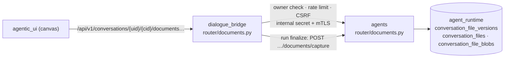
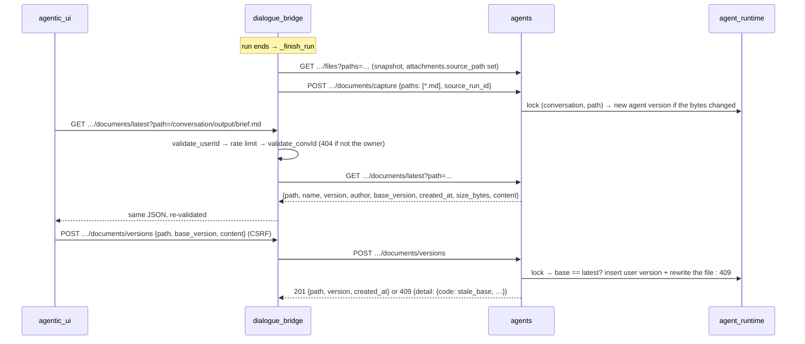
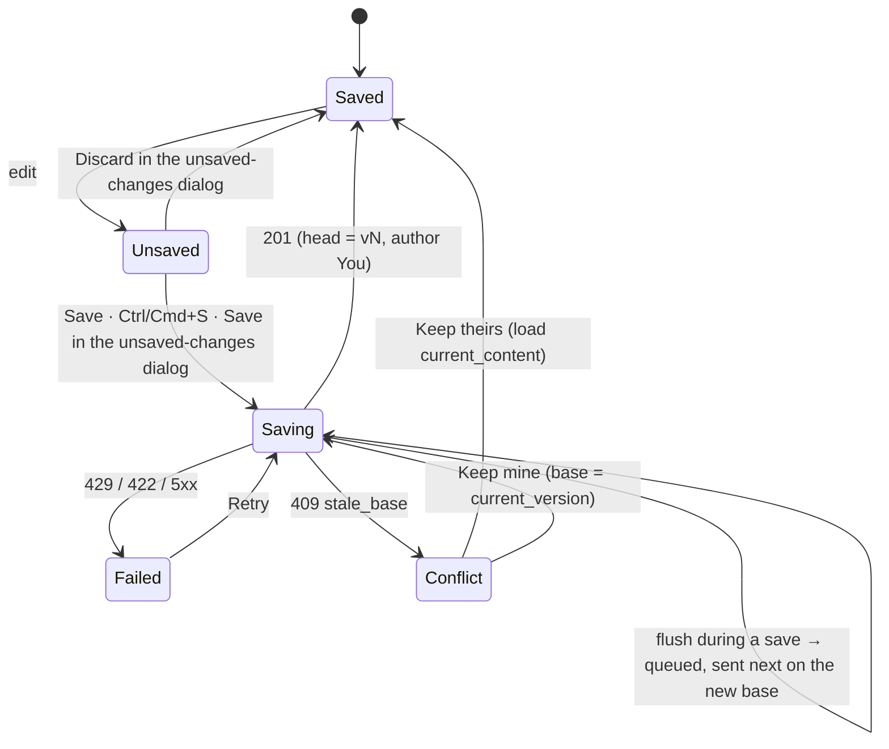

# Canvas — Documents and Their Versions

A **canvas document** is a markdown file the agent wrote under `/conversation/output/` and presented with `present_artifact` (plan 44). Only such files are documents: Office files and PDFs stay previews. Plan 36 keeps one row per path in `agent_runtime.conversation_files`, so an overwrite used to lose the old text; Phase 4.1 adds the history. Every version of a document is a row in `conversation_file_versions` naming the same encrypted, content-addressed blob a file does, and records its author (the agent or the user) and the version it was based on. The agents service owns the versions and their rules; the dialogue_bridge passes them through to the conversation's owner and, at the end of every run, asks the agents service to record what the agent presented. Phase 4.1 shipped the storage, the routes and a read-only canvas; Phase 4.2 makes the canvas an editor whose saves are the user's versions, with a conflict dialog, history, compare and restore. The agent loop, comments and export follow (see the last section).

---

## Services Involved

---

## Versions — Full Sequence

A run presents `brief.md`; the bridge snapshots it and records it as the agent's version; the user opens it in the canvas, edits it, and the canvas saves the edit as the user's version.

---

## Phase 1 — The agent's versions (capture)

The bridge already snapshots every presented file at finalize (`capture_presented_files`). Right after, `capture_canvas_documents` sends the presented paths that end `.md` under `/conversation/output/` to `POST …/documents/capture`. For each, the agents service compares the file's blob with the latest version's: different bytes become the next version with author `agent` and `source_run_id` the run; the same bytes add nothing. That makes the call idempotent, so a retried finalize is harmless. It is fail-open: a failure is a warning, and the document still gets its first version when it is opened.

| Key fact | Value / detail |
| --- | --- |
| Eligible path | normalised, under `/conversation/output/`, ending `.md` (also a CHECK on the table) |
| Skipped silently | ineligible paths, missing files, files over 1 MiB |
| Per path | one transaction under `pg_advisory_xact_lock(hashtextextended('conversation_file_versions\n<cid>\n<path>', 0))` |
| Attachment | `attachments.source_path` = the presented path (migration `0049`), so the card knows which document it is |

---

## Phase 2 — Opening a document

`GET …/documents/latest?path=` returns the latest version with its text. A document from before this release (or whose capture failed) has no versions: the first read records its current file as v1 by the agent, under the same lock, so two first reads record it once. `GET …/documents` lists each document at its latest version, newest first (the ▾ switcher); `GET …/documents/versions?path=` lists a document's history without text; `GET …/documents/versions/{n}?path=` returns one version.

| Key fact | Value / detail |
| --- | --- |
| UI path of a card | `sourcePath ?? "/conversation/output/" + fileName`, `.md` only |
| Lists | `limit` 1–200, default 100 |
| 404 | no version and no file; or no such version |
| 422 | a path that is not a canvas document |

---

## Phase 3 — Saving a version

`POST …/documents/versions {path, base_version, content}` saves the user's text as the next version, author `user`, `base_version` the version edited. It is refused with `409 {"detail": {"code": "stale_base", "message", "current_version", "current_content"}}` when `base_version` is not the latest — never last-write-wins. Saves of one document are serialised by the advisory lock, so of two saves from the same base exactly one wins. The saved text also replaces the document's `conversation_files` row: the agent's next turn reads the latest version, and the next capture of those bytes adds nothing.

| Key fact | Value / detail |
| --- | --- |
| Size cap | 1 MiB of UTF-8 (422 above) |
| Rate limits (bridge, per user) | reads `DOCUMENT_READ_RATE_LIMIT_*` 120/60 s, saves `DOCUMENT_SAVE_RATE_LIMIT_*` 30/60 s |
| CSRF | required on the save |

---

## Phase 4 — Editing in the canvas (4.2)

The canvas is a Plate editor over the same markdown pipeline as the reads (`features/canvas/lib/markdown.ts`). The header holds the save status; a mode menu top right switches **Editing / Viewing** (Suggesting is 4.6). A desktop opens a document for editing; a phone opens it for reading, with a floating ✎ button that switches to editing. An earlier version (picked from the byline or History) is always read-only. While editing, a floating pill toolbar sits at the bottom of the document: text style (Text, Title, Heading, Subheading), bold / italic / strikethrough / code, bulleted / numbered / checklist, link (web and `mailto:` URLs only), table (a size grid), quote, block actions. With a mouse the pill shows every control, compact, and wraps to a second row in a narrow canvas (never a scrollbar); on touch it scrolls sideways with a fade at the edge. **Undo / redo** sit in the row at the top of the document, beside the outline button (≡). Every icon button in the canvas (header, that row, the block handle, a section's fold chevron, the pill) has a tooltip with its name and shortcut (`CanvasHint`). Blocks can be selected whole and deleted, duplicated, moved or turned into another kind; tables have their own floating toolbar (see *Blocks, tables and touch* below).

| Rule | Detail |
| --- | --- |
| Header line | Docked beside the chat, the canvas header takes the chat header's measured height (`useChatHeaderHeight`, a ResizeObserver on `[data-chat-header]`, passed as `--canvas-header-h`), so the two bottom lines meet across the split |
| Unsaved means changed | An edit marks the document unsaved at once; 250 ms after the last edit the text is compared with the saved version's again, so a space typed and deleted, or an undo back to the saved text, shows **Saved** and hides the Save button |
| Saving is the user's call | No autosave (the user, 2026-11-18): a version is written only on **Save** (the header button, shown only while there are unsaved changes), **Ctrl/Cmd+S**, or **Save** in the unsaved-changes dialog. Closing the canvas, switching documents or restoring an old version with unsaved edits asks **Save / Discard / Cancel** (`CanvasUnsavedDialog`); reading an older version, a compare or switching to Viewing keeps the edits and asks nothing. Only an unmount the canvas cannot ask about (leaving the conversation) saves what is pending, so an edit is never lost silently |
| Save controller | `features/canvas/lib/saveController.ts`, one per open document (`useCanvasEditing`); the editor hands it a serializer and reports edits, the text is serialized only when a save is due |
| Base version | Every save sends `base_version` = the version the editor's text is based on; after a 201 the new version is the base of the next |
| Single flight | One save in flight per document; a flush that arrives meanwhile is queued and sent with the latest text once the first lands |
| No-op saves | Skipped: the text is compared with the base as the editor writes it (markdown → Plate → markdown), so opening and closing a document never makes a version |
| Unsaved work | `beforeunload` warns while anything is unsaved, saving or in conflict |
| Conflict dialog | On a 409: who saved vN (from the version list), **Compare**, **Keep theirs** (the latest text replaces the editor's), **Keep mine** (saves the editor's current text on top of vN). Closing it decides nothing — the header shows **Resolve** |
| History | The header's History button: every version with author (Agent / You), date and base; pick one to read it, tick two to **Compare**, **Restore** an earlier one = save its text as a new version on top of the latest (history is never rewritten). A bottom sheet on a phone |
| Compare | `lib/documentDiff.ts`: jsdiff (`diff`, BSD-3-Clause) line diff refined to words inside each changed stretch; both texts normalized first so markdown spelling (`\_`, `\| - \|`) is not shown as a change; long unchanged runs fold |
| Refresh after a run | The `revision` prop re-reads the latest version. Newer than the editor's base and nothing unsaved → the editor reloads with it, silently. Unsaved edits → a banner "The agent saved vN — Review", which opens the conflict dialog; the user's text is never overwritten |
| Own saves | Written into the query cache as the latest version, so they never look like a version from outside |
| Empty table cells | The serializer's zero-width spaces are dropped, so a new table reads as plain `\|  \|` cells |
| Trailing spaces | A space left at a line end (Enter after a space) is not written as `&#x20;`; code blocks are kept byte for byte |

### Blocks, tables and touch

Plate's block selection (`@platejs/selection`, MIT) works on the top-level blocks; a markdown document's nested blocks (cell paragraphs, code lines, quoted paragraphs) move with their parent. Every block command acts on the **target blocks**: the selected blocks, or else the blocks the text selection touches (`lib/blockCommands.ts`).

| Action | Desktop | Phone |
| --- | --- | --- |
| Select blocks | Drag from the margin beside the text; Esc selects the caret's block; Ctrl/Cmd+A twice; the ⋮⋮ handle (Shift+click adds a block); Shift+↑/↓ extends | The toolbar's Block button acts on the caret's block (the drag would fight scrolling, so it is off on touch) |
| Block menu | ⋮⋮ handle in the left margin on hover: Duplicate, Move up / down, Turn into ▸, Delete | Block button in the toolbar; Turn into opens its list in place of the menu |
| Turn into | Text, Title, Heading, Subheading, Bulleted / Numbered list, Checklist, Quote, Code. Text blocks change in place; a run turned into a quote or code becomes one quote / one code block; tables, rules and images are left alone | same |
| On selected blocks | Backspace / Delete removes them, typing replaces them, Ctrl/Cmd+C / X copy and cut them, marks and list / quote buttons apply to all of them, Ctrl/Cmd+Z / Ctrl+Y undo / redo one step | — |
| Table | Table button → size grid (6 × 6) → the table, caret in its first cell; an empty line at the caret is replaced. With the caret in a table, a floating toolbar: row above / below, delete row, column left / right, delete column, delete table. Inserts keep the caret in its cell | same; 44px buttons |
| Backspace / Delete (`lib/editorDelete.ts`) | In a table whose cells are all empty: removes the table. After / before a rule or image: removes it. At the start of a block after a table: an empty block goes, else the caret moves into the last cell (text is never merged into a cell). In an empty code block: back to a paragraph. A document never ends with no block | same |
| Paste (`lib/pasteCleanup.ts`) | Plate maps pasted HTML onto the canvas's nodes (anything else becomes text, so no raw HTML is stored); before that, script / style / iframe / object / svg / comments go, Office's `<o:p>`-style tags are unwrapped, Word's list paragraphs become real lists without their typed bullet, and images other than `http(s):` are dropped | same |
| Toolbar and selection | `mousedown` is prevented, so the editor keeps focus | Every control remembers the selection on `pointerdown` (and a plain button prevents it, so the editor and the keyboard stay put) and puts it back before its command, in case the tap collapsed it (`lib/selectionMemory.ts`); the pill moves above the on-screen keyboard (`hooks/useKeyboardInset.ts`, `visualViewport`); checklist boxes have a 44px hit area |

Every one of these is a change of the editor's value, so it marks the document unsaved, like typing.

---

## Sharp Edges and Behavioral Notes

- **The bridge path carries the user id** — `/v1/conversations/{user_id}/{conversation_id}/documents…`, like every conversation route, so `validate_userId` binds the session and `validate_convId` is the owner check. Someone else's conversation or a "Try it" trial is a 404 with no upstream call.
- **The document path is never a URL segment** — always a query or body field, so a `/` in it cannot change the route.
- **The blob GC counts versions** — a blob goes only when no file and no version names it, so an agent overwrite keeps every earlier version readable. Versions add no bytes when they match a file.
- **Fork, delete, purge** — `files/copy` copies the versions with the files (one transaction); the reap and the account purge delete them (the purge reports `conversation_file_versions`). The fork's attachments keep `source_path`.
- **Closing or switching saves, without waiting** — the pending edit is sent as the panel goes; the request outlives the panel. If that last save fails (or is refused), the edit is not shown again: only `beforeunload` (closing the tab) warns, the in-app close does not block.
- **The 409 does not say who saved** — the dialog asks the version list; until it answers it says "Someone".
- **Agent edits without presenting are not versions** — only a presented file is captured. In 4.1 an agent that edits a document and does not present it again leaves the latest version behind the file until the next presentation.
- **The 409 detail has a `message`** — the agents service's exception handler passes a structured 4xx detail through only when it carries one; the bridge re-validates the shape and returns 502 if it is malformed.
- **No retry on bridge → agents document calls** — a save retried after its first attempt landed would come back as a 409 against itself.
- **Logs never carry a path or content** — counts, versions, run ids and error types only.

---

## Coming next (4.3–4.6)

4.3 the agent loop (the latest version in the agent's filesystem every turn, a per-turn note with the user's diff and open comments, `conversation_file_seen`, Ask agent on a selection); 4.4 comments (`conversation_file_comments`, margin threads, `@agent` replies, `resolve_comment`); 4.5 export to Word / PDF / Markdown through the sandbox and PDF previews of Office files; 4.6 Suggesting mode, tabs and the "agent is writing here" marker.

---

## File Map

| Concept | File | What to look for |
| --- | --- | --- |
| Versions DDL, GC probe, fork copy, reap, purge | [magenticx/agents/harness/conversation_files/store.py](../../magenticx/agents/harness/conversation_files/store.py) | `_DDL`, `_collect_garbage`, `copy_conversation`, `delete_conversation`, `purge_user` |
| Version logic | [magenticx/agents/harness/conversation_files/versions.py](../../magenticx/agents/harness/conversation_files/versions.py) | `DocumentVersionStore`, `document_path`, `StaleBase`, `_lock` |
| Agents routes | [magenticx/agents/router/documents.py](../../magenticx/agents/router/documents.py) | the six internal routes |
| Agents endpoint logic / schemas | [magenticx/agents/utils/documents.py](../../magenticx/agents/utils/documents.py), [magenticx/agents/schema/documents.py](../../magenticx/agents/schema/documents.py) | `capture_documents`, `SaveDocumentVersionRequest` |
| Bridge routes | [magenticx/dialogue_bridge/router/documents.py](../../magenticx/dialogue_bridge/router/documents.py) | owner check, rate limits, CSRF |
| Bridge pass-through / schemas | [magenticx/dialogue_bridge/utils/documents.py](../../magenticx/dialogue_bridge/utils/documents.py), [magenticx/dialogue_bridge/schema/documents.py](../../magenticx/dialogue_bridge/schema/documents.py) | `_call`, `DocumentStaleBaseDetail` |
| Run-end capture + `source_path` | [magenticx/dialogue_bridge/utils/output_capture.py](../../magenticx/dialogue_bridge/utils/output_capture.py) | `capture_canvas_documents`, `canvas_document_paths`, `_source_path` |
| `attachments.source_path` | [magenticx/dialogue_bridge/core/database/migrations/versions/0049_attachment_source_path.py](../../magenticx/dialogue_bridge/core/database/migrations/versions/0049_attachment_source_path.py) | the column |
| Canvas editing (UI) | [magenticx/agentic_ui/src/features/canvas/](../../magenticx/agentic_ui/src/features/canvas/) | `lib/saveController.ts`, `hooks/useCanvasEditing.ts`, `components/DocumentCanvas.tsx`, `canvas_parts/CanvasToolbar.tsx`, `CanvasHistory.tsx`, `CanvasCompareView.tsx`, `CanvasConflictDialog.tsx` |
| Blocks, tables, touch (UI) | [magenticx/agentic_ui/src/features/canvas/](../../magenticx/agentic_ui/src/features/canvas/) | `lib/blockCommands.ts`, `lib/editorDelete.ts`, `lib/pasteCleanup.ts`, `lib/selectionMemory.ts`, `lib/editorKit.ts` (BlockSelectionPlugin), `hooks/useKeyboardInset.ts`, `canvas_parts/CanvasBlockMenu.tsx`, `CanvasTablePicker.tsx`, `CanvasTableElement.tsx`, `CanvasBlockFrame.tsx` |
| Save client + contract (UI) | [magenticx/agentic_ui/src/shared/lib/api/documents.ts](../../magenticx/agentic_ui/src/shared/lib/api/documents.ts), [schemas.ts](../../magenticx/agentic_ui/src/shared/lib/schemas.ts) | `saveDocumentVersion`, `CanvasDocumentSavedSchema`, `CanvasStaleBaseSchema` |
| UI tests | [tests/agentic_ui/canvas-editing.test.tsx](../../tests/agentic_ui/canvas-editing.test.tsx), [canvas-panel.test.tsx](../../tests/agentic_ui/canvas-panel.test.tsx), [canvas-blocks.test.tsx](../../tests/agentic_ui/canvas-blocks.test.tsx) | save rules, 409 paths, restore, refresh vs unsaved, the editing panel; tables, Backspace / Delete, block selection, turn into, the toolbar selection on a phone, paste, structural edits marking the document unsaved, the unsaved-changes dialog |
| Tests | [tests/agents/test_conversation_documents.py](../../tests/agents/test_conversation_documents.py), [tests/dialogue_bridge/test_documents.py](../../tests/dialogue_bridge/test_documents.py) | Postgres-backed version rules; bridge pass-through and finalize |
