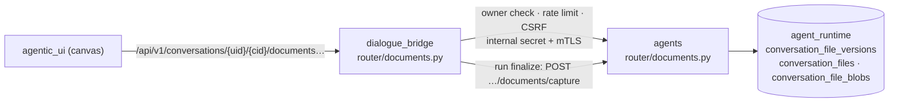
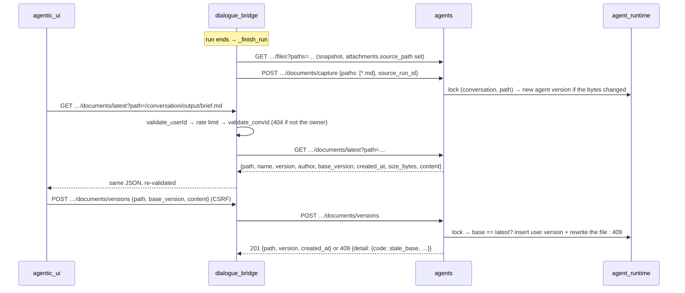

# Canvas — Documents and Their Versions

A **canvas document** is a markdown file the agent wrote under `/conversation/output/` and presented with `present_artifact` (plan 44). Only such files are documents: Office files and PDFs stay previews. Plan 36 keeps one row per path in `agent_runtime.conversation_files`, so an overwrite used to lose the old text; Phase 4.1 adds the history. Every version of a document is a row in `conversation_file_versions` naming the same encrypted, content-addressed blob a file does, and records its author (the agent or the user) and the version it was based on. The agents service owns the versions and their rules; the dialogue_bridge passes them through to the conversation's owner and, at the end of every run, asks the agents service to record what the agent presented. Phase 4.1 ships the storage, the routes and a read-only canvas; editing, the agent loop, comments and export follow (see the last section).

---

## Services Involved

---

## Versions — Full Sequence

A run presents `brief.md`; the bridge snapshots it and records it as the agent's version; the user opens it, and later saves an edit (the save UI arrives in 4.2, the route is live now).

---

## Phase 1 — The agent's versions (capture)

The bridge already snapshots every presented file at finalize (`capture_presented_files`). Right after, `capture_canvas_documents` sends the presented paths that end `.md` under `/conversation/output/` to `POST …/documents/capture`. For each, the agents service compares the file's blob with the latest version's: different bytes become the next version with author `agent` and `source_run_id` the run; the same bytes add nothing. That makes the call idempotent, so a retried finalize is harmless. It is fail-open: a failure is a warning, and the document still gets its first version when it is opened.

| Key fact | Value / detail |
| --- | --- |
| Eligible path | normalised, under `/conversation/output/`, ending `.md` (also a CHECK on the table) |
| Skipped silently | ineligible paths, missing files, files over 1 MiB |
| Per path | one transaction under `pg_advisory_xact_lock(hashtextextended('conversation_file_versions\n<cid>\n<path>', 0))` |
| Attachment | `attachments.source_path` = the presented path (migration `0049`), so the card knows which document it is |

---

## Phase 2 — Opening a document

`GET …/documents/latest?path=` returns the latest version with its text. A document from before this release (or whose capture failed) has no versions: the first read records its current file as v1 by the agent, under the same lock, so two first reads record it once. `GET …/documents` lists each document at its latest version, newest first (the ▾ switcher); `GET …/documents/versions?path=` lists a document's history without text; `GET …/documents/versions/{n}?path=` returns one version.

| Key fact | Value / detail |
| --- | --- |
| UI path of a card | `sourcePath ?? "/conversation/output/" + fileName`, `.md` only |
| Lists | `limit` 1–200, default 100 |
| 404 | no version and no file; or no such version |
| 422 | a path that is not a canvas document |

---

## Phase 3 — Saving a version

`POST …/documents/versions {path, base_version, content}` saves the user's text as the next version, author `user`, `base_version` the version edited. It is refused with `409 {"detail": {"code": "stale_base", "message", "current_version", "current_content"}}` when `base_version` is not the latest — never last-write-wins. Saves of one document are serialised by the advisory lock, so of two saves from the same base exactly one wins. The saved text also replaces the document's `conversation_files` row: the agent's next turn reads the latest version, and the next capture of those bytes adds nothing.

| Key fact | Value / detail |
| --- | --- |
| Size cap | 1 MiB of UTF-8 (422 above) |
| Rate limits (bridge, per user) | reads `DOCUMENT_READ_RATE_LIMIT_*` 120/60 s, saves `DOCUMENT_SAVE_RATE_LIMIT_*` 30/60 s |
| CSRF | required on the save |

---

## Sharp Edges and Behavioral Notes

- **The bridge path carries the user id** — `/v1/conversations/{user_id}/{conversation_id}/documents…`, like every conversation route, so `validate_userId` binds the session and `validate_convId` is the owner check. Someone else's conversation or a "Try it" trial is a 404 with no upstream call.
- **The document path is never a URL segment** — always a query or body field, so a `/` in it cannot change the route.
- **The blob GC counts versions** — a blob goes only when no file and no version names it, so an agent overwrite keeps every earlier version readable. Versions add no bytes when they match a file.
- **Fork, delete, purge** — `files/copy` copies the versions with the files (one transaction); the reap and the account purge delete them (the purge reports `conversation_file_versions`). The fork's attachments keep `source_path`.
- **Agent edits without presenting are not versions** — only a presented file is captured. In 4.1 an agent that edits a document and does not present it again leaves the latest version behind the file until the next presentation.
- **The 409 detail has a `message`** — the agents service's exception handler passes a structured 4xx detail through only when it carries one; the bridge re-validates the shape and returns 502 if it is malformed.
- **No retry on bridge → agents document calls** — a save retried after its first attempt landed would come back as a 409 against itself.
- **Logs never carry a path or content** — counts, versions, run ids and error types only.

---

## Coming next (4.2–4.6)

4.2 editing in the canvas (rich text saved as versions, the conflict dialog, history with compare and restore); 4.3 the agent loop (the latest version in the agent's filesystem every turn, a per-turn note with the user's diff and open comments, `conversation_file_seen`, Ask agent on a selection); 4.4 comments (`conversation_file_comments`, margin threads, `@agent` replies, `resolve_comment`); 4.5 export to Word / PDF / Markdown through the sandbox and PDF previews of Office files; 4.6 Suggesting mode, tabs and the "agent is writing here" marker.

---

## File Map

| Concept | File | What to look for |
| --- | --- | --- |
| Versions DDL, GC probe, fork copy, reap, purge | [magenticx/agents/harness/conversation_files/store.py](../../magenticx/agents/harness/conversation_files/store.py) | `_DDL`, `_collect_garbage`, `copy_conversation`, `delete_conversation`, `purge_user` |
| Version logic | [magenticx/agents/harness/conversation_files/versions.py](../../magenticx/agents/harness/conversation_files/versions.py) | `DocumentVersionStore`, `document_path`, `StaleBase`, `_lock` |
| Agents routes | [magenticx/agents/router/documents.py](../../magenticx/agents/router/documents.py) | the six internal routes |
| Agents endpoint logic / schemas | [magenticx/agents/utils/documents.py](../../magenticx/agents/utils/documents.py), [magenticx/agents/schema/documents.py](../../magenticx/agents/schema/documents.py) | `capture_documents`, `SaveDocumentVersionRequest` |
| Bridge routes | [magenticx/dialogue_bridge/router/documents.py](../../magenticx/dialogue_bridge/router/documents.py) | owner check, rate limits, CSRF |
| Bridge pass-through / schemas | [magenticx/dialogue_bridge/utils/documents.py](../../magenticx/dialogue_bridge/utils/documents.py), [magenticx/dialogue_bridge/schema/documents.py](../../magenticx/dialogue_bridge/schema/documents.py) | `_call`, `DocumentStaleBaseDetail` |
| Run-end capture + `source_path` | [magenticx/dialogue_bridge/utils/output_capture.py](../../magenticx/dialogue_bridge/utils/output_capture.py) | `capture_canvas_documents`, `canvas_document_paths`, `_source_path` |
| `attachments.source_path` | [magenticx/dialogue_bridge/core/database/migrations/versions/0049_attachment_source_path.py](../../magenticx/dialogue_bridge/core/database/migrations/versions/0049_attachment_source_path.py) | the column |
| Tests | [tests/agents/test_conversation_documents.py](../../tests/agents/test_conversation_documents.py), [tests/dialogue_bridge/test_documents.py](../../tests/dialogue_bridge/test_documents.py) | Postgres-backed version rules; bridge pass-through and finalize |
